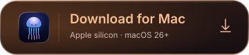

# Rocuronium

Rocuronium gives an AI agent a separate macOS login session with its own desktop and cursor. Local vision models help find UI elements when accessibility data is missing, and each interaction returns evidence of what actually changed: `confirmed`, `noEffect`, or `unverifiable`.

## Highlights

- Work in a separate login session while the agent uses its own desktop and cursor.
- Detect failed interactions even when macOS reports that the API call succeeded.
- Find controls with local vision models when an app exposes little accessibility information.

Full feature list

- **Observation:** accessibility trees, element search, on-device OCR, window screenshots, and structural or pixel diffs.
- **Interactions:** click, type, keys, shortcuts, menus, scrolling, app launch, and window controls.
- **Evidence:** `confirmed`, `noEffect`, or `unverifiable`, with read-back, focus, window, selection, or pixel changes.
- **Isolation:** a dedicated agent session, virtual displays, and window parking.
- **Plans:** sequential actions with postconditions and abort, continue, pause-for-human, or fallback policies.
- **Human control:** visible activity, approval before taking the human cursor, and emergency stop **⌃⌥⇧⎋**. Resume requires the app’s popover.
- **Automation:** CLI and MCP tools. Session creation requires human approval; MCP can inspect or stop a session.

## Notes

- Apple silicon · macOS 26.5+ · Accessibility permission; Screen Recording for screenshots and OCR.
- Homebrew: `brew install kageroumado/tap/rocuronium`.
- [Commands and model reference](REFERENCE.md) · [Agent setup and MCP configuration](.claude/skills/rocuronium/SKILL.md), also available through `rocuronium guide`.
